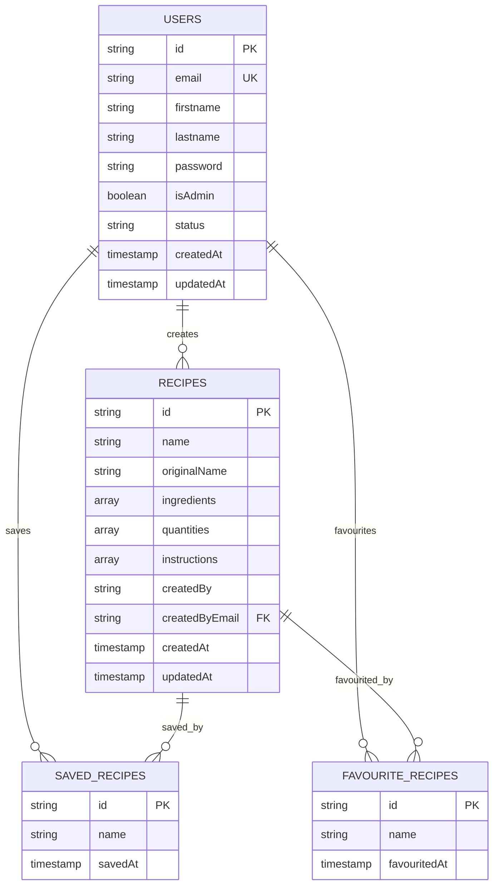

# Recipe Finder Project - Entity Relationship Diagram

## Database Schema Overview

The Recipe Finder project uses Firebase Firestore as its database with the following main collections and relationships:

## Main Entities

### 1. Users Collection
```
Users {
  - id (document ID)
  - email (string, unique)
  - firstname (string)
  - lastname (string)
  - password (string, hashed)
  - isAdmin (boolean, default: false)
  - status (string, default: 'active')
  - createdAt (timestamp)
  - updatedAt (timestamp)
}
```

### 2. Recipes Collection
```
Recipes {
  - id (document ID, auto-generated slug)
  - name (string)
  - originalName (string)
  - ingredients (array of strings)
  - quantities (array of strings)
  - instructions (array of objects) {
    - text (string)
    - time (number, seconds)
  }
  - createdBy (string, full name)
  - createdByEmail (string, foreign key to Users.email)
  - createdAt (timestamp)
  - updatedAt (timestamp)
}
```

### 3. User Subcollections

#### 3.1 Saved Recipes Subcollection
```
Users/{userId}/savedRecipes {
  - id (document ID, recipe ID)
  - name (string, recipe name)
  - savedAt (timestamp)
}
```

#### 3.2 Favourite Recipes Subcollection
```
Users/{userId}/favouriteRecipes {
  - id (document ID, recipe ID)
  - name (string, recipe name)
  - favouritedAt (timestamp)
}
```

## Entity Relationships



## Detailed Relationships

### 1. User-Recipe Relationship (One-to-Many)
- **Relationship**: A user can create multiple recipes
- **Foreign Key**: `Recipes.createdByEmail` references `Users.email`
- **Cardinality**: One user can create many recipes, each recipe has one creator

### 2. User-Saved Recipes Relationship (Many-to-Many)
- **Relationship**: Users can save multiple recipes, recipes can be saved by multiple users
- **Implementation**: Subcollection `Users/{userId}/savedRecipes`
- **Cardinality**: Many-to-many relationship

### 3. User-Favourite Recipes Relationship (Many-to-Many)
- **Relationship**: Users can favourite multiple recipes, recipes can be favourited by multiple users
- **Implementation**: Subcollection `Users/{userId}/favouriteRecipes`
- **Cardinality**: Many-to-many relationship

## Database Collections Structure

```
Firebase Firestore Database
├── users (collection)
│   ├── {userId} (document)
│   │   ├── email
│   │   ├── firstname
│   │   ├── lastname
│   │   ├── password
│   │   ├── isAdmin
│   │   ├── status
│   │   ├── createdAt
│   │   ├── updatedAt
│   │   ├── savedRecipes (subcollection)
│   │   │   ├── {recipeId} (document)
│   │   │   │   ├── name
│   │   │   │   └── savedAt
│   │   └── favouriteRecipes (subcollection)
│   │       ├── {recipeId} (document)
│   │       │   ├── name
│   │       │   └── favouritedAt
│   └── ...
└── recipes (collection)
    ├── {recipeId} (document)
    │   ├── name
    │   ├── originalName
    │   ├── ingredients (array)
    │   ├── quantities (array)
    │   ├── instructions (array of objects)
    │   ├── createdBy
    │   ├── createdByEmail
    │   ├── createdAt
    │   └── updatedAt
    └── ...
```

## Key Features of the Schema

### 1. User Management
- **Authentication**: Firebase Auth integration
- **User Roles**: Admin and regular user roles
- **User Status**: Active/inactive status tracking
- **Profile Management**: First name, last name, email

### 2. Recipe Management
- **Recipe Creation**: Users can create recipes with ingredients and instructions
- **Ingredient Tracking**: Ingredients with quantities
- **Instruction Steps**: Step-by-step instructions with timing
- **Creator Attribution**: Tracks who created each recipe

### 3. User Interactions
- **Save Recipes**: Users can save recipes for later viewing
- **Favourite Recipes**: Users can mark recipes as favourites
- **Recipe Discovery**: Search by recipe name or ingredients

### 4. Admin Features
- **User Management**: Admins can view, edit, and delete users
- **Recipe Management**: Admins can manage all recipes
- **System Administration**: Admin dashboard and controls

## Data Flow

1. **User Registration/Login**: Creates/authenticates user in Firebase Auth
2. **Recipe Creation**: User creates recipe → stored in Recipes collection
3. **Recipe Discovery**: Search recipes by name or ingredients
4. **User Actions**: Save/favourite recipes → stored in user subcollections
5. **Admin Management**: Admin manages users and recipes through admin interface

## Security Rules (Firebase Firestore)

```javascript
// Example security rules structure
rules_version = '2';
service cloud.firestore {
  match /databases/{database}/documents {
    // Users can read/write their own data
    match /users/{userId} {
      allow read, write: if request.auth != null && request.auth.uid == userId;
      
      // Subcollections
      match /savedRecipes/{recipeId} {
        allow read, write: if request.auth != null && request.auth.uid == userId;
      }
      
      match /favouriteRecipes/{recipeId} {
        allow read, write: if request.auth != null && request.auth.uid == userId;
      }
    }
    
    // Recipes - anyone can read, only creators can write
    match /recipes/{recipeId} {
      allow read: if true;
      allow write: if request.auth != null && 
        resource.data.createdByEmail == request.auth.token.email;
    }
  }
}
```

This ER diagram represents the complete data structure of the Recipe Finder project, showing how users, recipes, and user interactions are organized in the Firebase Firestore database. 